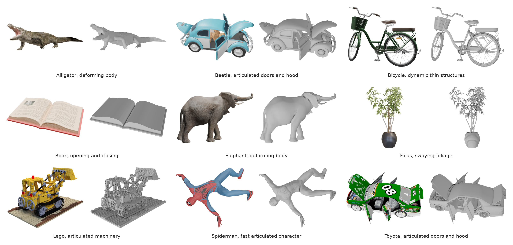

# Blender-Moments

Blender-Moments is a multi-view benchmark for dynamic surface reconstruction. It has nine animated Blender scenes, each rendered from 50 training and 10 test cameras at every frame, with ground-truth meshes extracted from the animated scene itself.



This repository holds the pipeline that generated the data: rendering, ground-truth mesh extraction, and COLMAP triangulation, with the exact configuration used. The data itself is on HuggingFace at [royorel/Blender-Moments](https://huggingface.co/datasets/royorel/Blender-Moments).

## Downloading

Downloads unpack into this repository's directory by default (`--dataset-root` picks another), and an interrupted download resumes where it stopped.

```bash
git clone https://github.com/royorel/Blender-Moments.git
cd Blender-Moments
pip install huggingface_hub

python scripts/download_data.py                                    # all scenes, all components
python scripts/download_data.py --scenes lego_4d book              # two scenes
python scripts/download_data.py --components meshes                # ground-truth meshes only
python scripts/download_data.py --scenes lego_4d --components images sfm
python scripts/download_blend.py                                   # source .blend files, into raw/
python scripts/download_blend.py --scenes lego_4d
```

| Component | `download_data.py --components` | Contents | Size |
| --- | --- | --- | --- |
| Renders | `images` | Training and test images with `transforms_train.json` and `transforms_test.json` | 26.3 GB |
| Ground-truth meshes | `meshes` | 10 meshes per scene and `scene_normalization.json` | 0.6 GB |
| COLMAP point clouds | `sfm` | One sparse point cloud per frame | 0.06 GB |
| Source scenes | `download_blend.py` | One `.blend` file per scene | 1.0 GB |

After downloading, the dataset root holds

- `raw/<scene>.blend`, the source scenes,
- `processed/<scene>/`, with `train/`, `test/`, `transforms_train.json`, `transforms_test.json`, and `sfm_init/frame_<N>/colmap_points3D.ply`,
- `synthetic_gt/<scene>/`, with `frame_<NNNN>.ply` and `scene_normalization.json`.

Images are named `frame_<NNNN>_view_<NNNN>.png`, with RGBA pixels on a transparent background. The transforms files follow the Blender-NeRF format, with each frame's time in `t`. Cameras are fixed across frames.

## Scenes

| Scene | Frames | Training images | Test images |
| --- | --- | --- | --- |
| alligator | 100 | 5000 | 1000 |
| beetle | 150 | 7500 | 1500 |
| bicycle | 100 | 5000 | 1000 |
| book | 170 | 8500 | 1700 |
| elephant | 100 | 5000 | 1000 |
| ficus_4d | 100 | 5000 | 1000 |
| lego_4d | 100 | 5000 | 1000 |
| spiderman | 120 | 6000 | 1200 |
| toyota | 150 | 7500 | 1500 |

All scenes are rendered at 800 by 800 pixels with Cycles at 128 samples. Cameras are sampled uniformly over the upper hemisphere (elevations 0 to 90 degrees), except alligator, whose band spans -10 to 70 degrees to include its underside. Ground-truth meshes are extracted at 10 evenly spaced frames per scene.

## Evaluation

To compare with the results reported in the paper, evaluate with the scripts and protocol of the [MEMO repository](https://github.com/royorel/MEMO), which cover both image metrics on the test views and geometric metrics against the ground-truth meshes. Each scene's `scene_normalization.json` holds the diagonal of its bounding box over the ground-truth frames, the constant by which the geometric metrics are normalized.

## Extracting additional ground-truth meshes (CPU only)

The published ground truth covers 10 frames per scene. Meshes for any other frame can be extracted from the scene's `.blend` file, without rendering anything.

```bash
cd Blender-Moments
conda env create -f blender_moments_env.yaml
conda run --no-capture-output -n blender_moments python scripts/download_blend.py --scenes lego_4d

# Every frame of lego_4d (1 to 100) into extra_gt/lego_4d/
conda run --no-capture-output -n blender_moments python scripts/extract_mesh.py \
    --object_path raw/lego_4d.blend --output_dir extra_gt/lego_4d \
    --frame_start 1 --frame_end 100 --frames $(seq 1 100)
```

`--frames` takes any list of frame numbers. Without it, `--n_frames N` extracts N evenly spaced frames between `--frame_start` and `--frame_end`. Each scene's frame range is in the [Scenes](#scenes) table.

**Write the meshes outside `synthetic_gt/`.** The extraction also writes a `scene_normalization.json` computed over the frames you extract, while evaluation against the published meshes uses the published one.

## Generating new data (GPU required)

The generation pipeline makes your own version of Blender-Moments, for example with other camera rigs, resolutions, frame ranges, or ground-truth frames, or with new scenes. Describe the version in the manifest, then run the pipeline on a Slurm cluster or sequentially on one GPU.

**The version used in the MEMO paper is already published, so to use it, download it as described in [Downloading](#downloading) rather than generating it.**

### Configuring a new version

Every generation setting lives in `manifests/blender_moments.yaml`, so a new version of the data is a new rig or scene entry, with no code changes. The defaults below are the values that produced the published data. A rig must give every setting except `min_azimuth`, `max_azimuth`, `seed`, `elevation_sampling`, and `pixel_filter`, which fall back to their defaults, and `gt_mesh_frames` falls back to the manifest's `defaults` entry.

| Setting | Where | Default | Effect |
| --- | --- | --- | --- |
| `train_count`, `test_count` | Rig | 50, 10 | Number of training and test cameras |
| `min_elevation`, `max_elevation` | Rig | 0, 90 | Elevation band in degrees, sampled area-uniformly (0 is the horizon, 90 the top) |
| `min_azimuth`, `max_azimuth` | Rig | 0, 360 | Azimuth range in degrees, measured from +x toward +y |
| `seed` | Rig | 42 | Camera-sampling seed |
| `pixel_filter` | Rig | `blend` | `blend` keeps the scene file's own Cycles pixel filter width (anti-aliased edges); `sharp` caps it at 0.01 px |
| `elevation_sampling` | Rig | `band` | `band` samples the elevation band area-uniformly; `blendernerf` uses BlenderNeRF's original upper-hemisphere sampler, which ignores the band |
| `focal_mm`, `resolution_x`, `resolution_y` | Rig | 50, 800, 800 | Camera focal length and image size |
| `cycles_samples` | Rig | 128 | Render samples per pixel |
| `frame_range` | Scene | | First and last rendered frame |
| `gt_mesh_frames` | Defaults or scene | 10 | Ground-truth frames, either a count of evenly spaced frames (the midpoints of equal sub-ranges of `frame_range`) or a list of frame numbers |
| `--fixed-cameras` / `--no-fixed-cameras` | `render_all.py` flag | fixed | One camera set for every frame, or a fresh set per frame |

For example, this renders the first 50 frames of Lego from 100 training cameras on one side of the scene, and extracts ground truth at three chosen frames.

```yaml
defaults:
  rig_definitions:
    half_100_10:
      train_count: 100
      test_count: 10
      cycles_samples: 128
      min_elevation: 0
      max_elevation: 90
      min_azimuth: 0
      max_azimuth: 180
      seed: 7
      focal_mm: 50
      resolution_x: 800
      resolution_y: 800

scenes:
  - name: lego_half
    source: local_blender
    source_blend: lego_4d.blend
    rig: half_100_10
    frame_range: [1, 50]
    gt_mesh_frames: [10, 25, 40]
```

Outputs land in `processed/<scene name>/` and `synthetic_gt/<scene name>/`, in the same layout as the downloaded data.

**We highly recommend Slurm: a sequential run can take several days, while Slurm runs every frame as its own job and finishes in hours to a day with good GPU availability.**

### Running on Slurm (highly recommended)

In Slurm mode, the pipeline submits a separate GPU job for every frame of every scene, first to render it and then to run COLMAP on it.

**Step 1. Set up once.** Install the environments, fetch the source scenes, and create your cluster settings file. Requires conda and a CUDA toolkit with `nvcc` on the path.

```bash
git clone https://github.com/royorel/Blender-Moments.git
cd Blender-Moments
bash install.sh
conda run --no-capture-output -n blender_moments python scripts/download_blend.py   # source scenes into raw/
cp slurm_config.local.example.yaml slurm_config.local.yaml
```

Then open `slurm_config.local.yaml` and replace each `<...>` value, on the lines marked `EDIT`, with your cluster's. Jobs fail to submit until these are filled in.

```yaml
common:
  partition: <gpu-partition>          # EDIT: the partition to submit GPU jobs to
  account: <slurm-account>            # EDIT: your Slurm account, or "" if none is required
  modules:                            # EDIT: modules to load in every job, or []
    - <cuda-module>                   #       for example cuda/12.4
  conda_init: <path/to/conda.sh>      # EDIT: for example /home/me/miniconda3/etc/profile.d/conda.sh

render:
  constraint: ""                      # OPTIONAL: node features for render jobs, for example a GPU type
```

Each job gets 6 CPUs, 32 GB, one GPU, and 4 hours, set in `slurm_config.yaml` and overridable here with the same keys. Blender 4.5 ships precompiled Cycles kernels only for `sm_86` and `sm_89` GPUs, and on others every render job compiles them first, so you may want to set the render `constraint` to those GPUs.

**Step 2. Run.** This runs the whole pipeline for all scenes. The `process_distributed.py` command keeps running until the last scene's COLMAP jobs are done, which can take hours, so start it inside `tmux` or `screen` to keep it alive if you disconnect.

```bash
cd Blender-Moments
# Rendering and COLMAP for every scene, one job per frame
conda run --no-capture-output -n blender_moments python scripts/process_distributed.py
# Ground-truth meshes, a few minutes on a CPU
conda run --no-capture-output -n blender_moments python scripts/extract_mesh_all.py
```

To run the stages yourself instead, use the block below, shown for one scene.

```bash
cd Blender-Moments
S=lego_4d

# Preview the job scripts, then submit one render job per frame
conda run --no-capture-output -n blender_moments python scripts/render_all.py --mode distributed --scenes $S --dry-run
conda run --no-capture-output -n blender_moments python scripts/render_all.py --mode distributed --scenes $S

# Wait for the render jobs to leave the queue
while squeue -u $USER -h -o %j | grep -q "^render_blender_moments_${S}_"; do sleep 60; done

# Submit one COLMAP job per frame, and wait again
conda run --no-capture-output -n bm_colmap python scripts/run_colmap_all.py --mode distributed --scenes $S
while squeue -u $USER -h -o %j | grep -q "^colmap_blender_moments_${S}_"; do sleep 60; done

# Ground-truth meshes, a few minutes on a CPU
conda run --no-capture-output -n blender_moments python scripts/extract_mesh_all.py --scenes $S
```

Rerunning any of these commands after failed or preempted jobs resubmits only the frames that are still missing.

**Good to know**

- Rendering first writes each scene's camera files with a short Blender run on the machine where you launch the command. If your cluster forbids that on login nodes, launch from an interactive job.
- Each job logs to `logs/sbatch/<job name>_<job id>.log`.
- `render_all.py --exclude <nodes>` keeps render jobs off nodes that misbehave.
- `process_distributed.py` waits for all your jobs named `render_*` or `colmap_*`, so don't run other jobs with those names at the same time.

### Running sequentially

In sequential mode, everything runs in your shell on one GPU, one scene and one frame at a time.

**Step 1. Set up once.** Install the environments and fetch the source scenes. Requires conda and a CUDA toolkit with `nvcc` on the path.

```bash
git clone https://github.com/royorel/Blender-Moments.git
cd Blender-Moments
bash install.sh
conda run --no-capture-output -n blender_moments python scripts/download_blend.py   # source scenes into raw/
```

**Step 2. Run.** This runs the whole pipeline for all scenes. It takes several days, so start it inside `tmux` or `screen` to keep it alive if you disconnect.

```bash
cd Blender-Moments
# Rendering, then COLMAP, scene by scene
conda run --no-capture-output -n blender_moments python scripts/process_sequential.py
# Ground-truth meshes, a few minutes on a CPU
conda run --no-capture-output -n blender_moments python scripts/extract_mesh_all.py
```

To run the stages yourself instead, use the block below, shown for one scene.

```bash
cd Blender-Moments
S=lego_4d

# Render every frame of the scene
conda run --no-capture-output -n blender_moments python scripts/render_all.py --mode sequential --scenes $S
# COLMAP on every frame
conda run --no-capture-output -n bm_colmap python scripts/run_colmap_all.py --mode sequential --scenes $S
# Ground-truth meshes
conda run --no-capture-output -n blender_moments python scripts/extract_mesh_all.py --scenes $S
```

**Good to know:** if a scene's rendering is interrupted, delete `processed/<scene>/` before rerunning it, since a sequential render stops when it finds the scene's camera files already written.

## License

The scripts are released under the MIT license (`LICENSE`). The vendored add-on in `scripts/BlenderNeRFRenderer/` keeps its own MIT license and citation file.

The data is released for non-commercial use under CC BY-NC 4.0, with each scene also subject to the license of its source model.

| Scene | Source model | Author | License |
| --- | --- | --- | --- |
| alligator | ["American Aligator from COTW game"](https://skfb.ly/pvzDY) | Game-animal ripper | CC BY-NC 4.0 |
| beetle | ["Beetle/Fusca (Version 1)"](https://skfb.ly/6GFDP) | soujagah | CC BY 4.0 |
| bicycle | ["002_Gym Equipment_Bicycle with Basket_Animated"](https://skfb.ly/pFtC7) | Average3DmodelEnjoyer | CC BY 4.0 |
| book | ["Book"](https://skfb.ly/6TJRN) | zoging | CC BY 4.0 |
| elephant | ["African Elephant (By jimmyho905)"](https://skfb.ly/pCMI9) | Otherspectre | CC BY 4.0 |
| ficus_4d | ["ficus"](https://www.blendswap.com/blend/23125), through the NeRF synthetic dataset, with motion authored for Blender-Moments | Herberhold | CC0 |
| lego_4d | ["lego"](https://www.blendswap.com/blend/11490), through the NeRF synthetic dataset, with its built-in animation activated | Heinzelnisse | CC BY-NC |
| spiderman | ["Spider-Man 2 Advanced Suit 2.0 PS5"](https://skfb.ly/oOYJt) | jerrylxia | CC BY 4.0 |
| toyota | ["Toyota Chaser TourerV"](https://sketchfab.com/3d-models/ecc85a571cb64a2f94b77fae1d975b64), through Objaverse (UID ecc85a571cb64a2f94b77fae1d975b64) | Swiss_Fox | CC BY 4.0 |

`attributions.txt` holds the same attributions in plain text.

## Acknowledgements

The Blender rendering uses a modified copy of [BlenderNeRF](https://github.com/maximeraafat/BlenderNeRF) by Maxime Raafat, in `scripts/BlenderNeRFRenderer/`.

## Citation

The citation will be added with the arXiv version of the paper.
